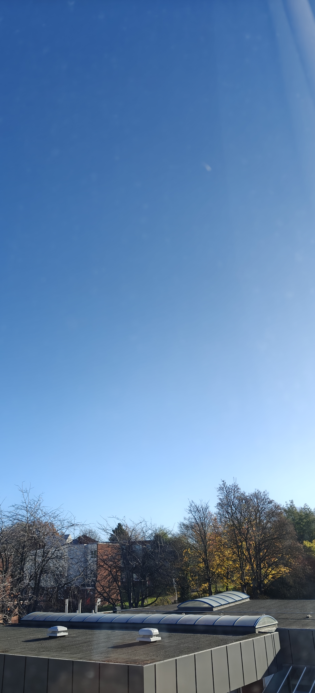
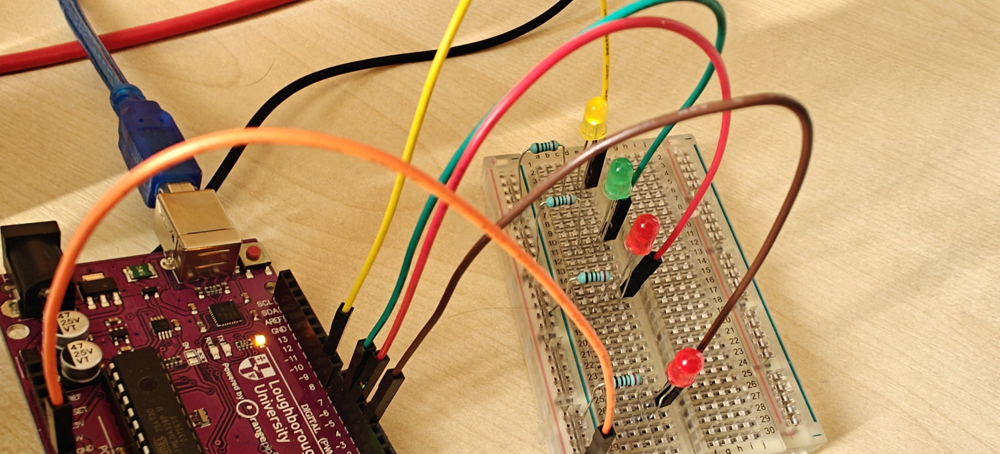
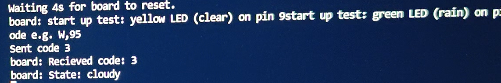
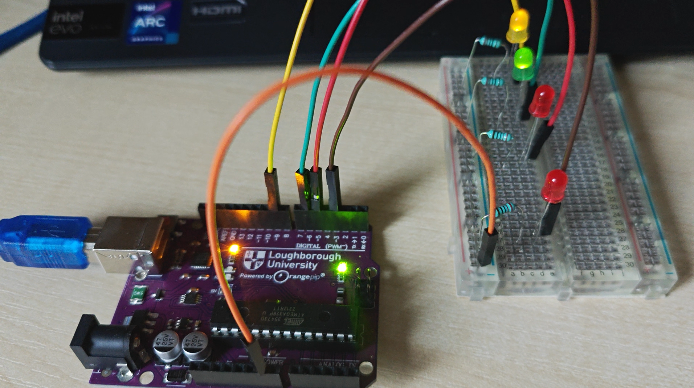
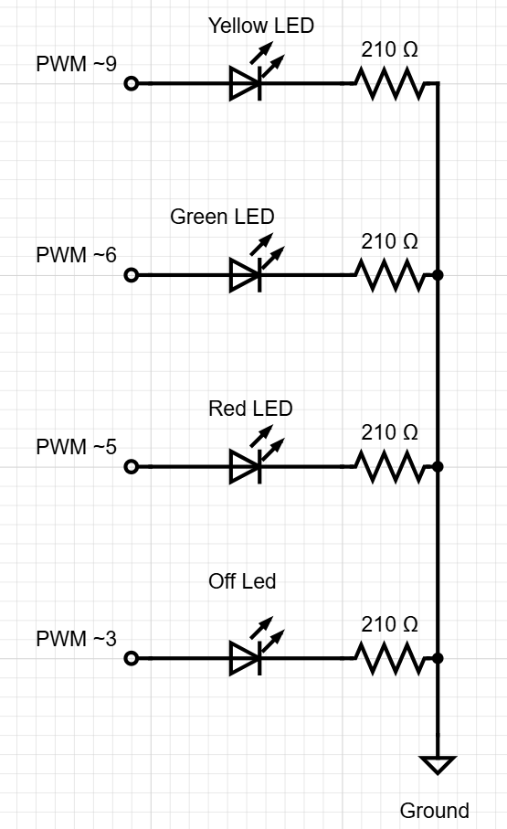

# weatherCube

A small 3D-printed cube that reads local weather and shows it as light.
The aim is a self-contained desk object, with a Wi-Fi microcontroller, an LED ring, a speaker and a battery, that you can glance at to know the weather outside.

This is a solo project to build practical electronic skills across electronics, firmware, CAD and manufacturing.

**Current Status:**
Stage 1 is complete. A working prototype on an Arduino Uno clone fetches live weather through a laptop and displays it on 4 LEDs. The final hardware has not been bought yet.

## Demo

| Live weather: clear sky | LEDs for clear (yellow breathing) |
|---|---|
|  |  |

| Bridge output | LEDs for cloudy (yellow and green) |
|---|---|
|  |  |

## How it works

```
Open-Meteo API --> bridge.py (laptop) --USB serial--> Uno firmware --> LEDs
   weather code      "W,<code>\n"          every 10 min        state machine + patterns
```

1. `bridge/` fetches the current WMO weather code from the free [Open-Meteo](https://open-meteo.com/) API every 10 minutes and sends it over USB serial as `W,<code>`.
2. The firmware maps the code to one of six states: clear, cloudy, rain, snow, storm or offline.
3. Each state has its own LED pattern, for example a slow breath for clear and a random flicker with flashes for storm.
4. If no valid message arrives for 30 minutes, the cube shows an offline state.

The laptop bridge is a deliberate stepping stone. The final device (Seeed XIAO ESP32-C3) will fetch the weather itself, and the same state mapping and pattern logic will carry over.

## Weather states

| State | WMO codes | Prototype behaviour |
|---|---|---|
| Clear | 0, 1 | Slow yellow breath |
| Cloudy | 2, 3, 45, 48, and any unknown code | Steady dim yellow plus green |
| Rain | 51 to 57, 61 to 67, 80 to 82 | Fast green pulse |
| Snow | 71 to 77, 85, 86 | Slow green pulse |
| Storm | 95, 96, 99 | Random red flicker with bright flashes |
| Offline | none (watchdog only) | Slow red blink |

Full detail is in [docs/weatherMapping.md](docs/weatherMapping.md).

## Design decisions

- **Testable logic:** the code-to-state mapping has no Arduino dependency, so it is unit-tested on the PC with Unity (8 tests).
- **Non-blocking:** LED patterns are driven by `millis()` with no `delay()` in the main loop, so serial input is always responsive.
- **Fail-safe:** the bridge never raises on a network failure. It sends nothing, and the firmware's watchdog shows the offline state.
- **Strict protocol:** the firmware accepts only `W,` followed by one to three digits and silently ignores anything else. See [docs/serialProtocol.md](docs/serialProtocol.md).
- **Central configuration:** pins, timings and brightness live in `firmware/include/config.h`.
- **Secrets stay out of git:** the real `bridge/config.json` (coordinates and serial port) is gitignored, and only `config.example.json` is committed.

## Hardware

**Prototype (current):** Orangepip Kona328 (Arduino Uno clone), four LEDs, four 210 Ω resistors, breadboard. Wiring is in [docs/wiring.md](docs/wiring.md).



**Final design (planned):** Seeed XIAO ESP32-C3, 12-LED WS2812B ring, MAX98357A I2S amplifier with a 3 W speaker, 1200 mAh LiPo, frosted diffuser, and a 3D-printed enclosure designed in Siemens NX. Estimated cost is about £35 to £40.

## Roadmap

- [x] 1. Firmware on a breadboard prototype, with laptop weather bridge
- [ ] 2. Port to ESP32-C3 with on-device Wi-Fi and weather fetch
- [ ] 3. Power measurement
- [ ] 4. CAD of the enclosure
- [ ] 5. Print and iterate
- [ ] 6. Assembly and test
- [ ] 7. Final documentation
- [ ] Stretch: custom PCB in KiCad

## Repository layout

```
firmware/   PlatformIO project (env:uno for the board, env:native for PC unit tests)
bridge/     Python script that fetches weather and feeds the board
docs/       Weather mapping, serial protocol, wiring, images
hardware/   Bill of materials, CAD and schematics (in progress)
```

## Running it

Requirements: PlatformIO, Python 3, and an Arduino Uno (or compatible).

```
# firmware (from firmware/)
pio run -e uno -t upload
pio test -e native            # unit tests on the PC

# bridge (from the repository root)
pip install -r bridge/requirements.txt
copy bridge\config.example.json bridge\config.json   # then set your coordinates and COM port
python bridge/bridge.py
```

Close any open serial monitor first, because only one program can use the port at a time.

## What I learnt so far

- **Breadboard debugging:** an early fault had all four LEDs connected along the same line, which stopped the circuit working properly. I found it by isolating one LED, resistor and ground path at a time.
- **Auto-reset on connect:** opening the serial port resets the Uno, so the first message can be lost. The bridge waits for the bootloader and startup test before sending.
- **A one-character bug:** `&` instead of `%` in the triangle-wave function made the animations erratic. It was found by reading the code once the logic was ruled out.
- **Separating logic from hardware:** keeping the mapping free of Arduino code made it easy to test on the PC and will make the ESP32 port simpler.

