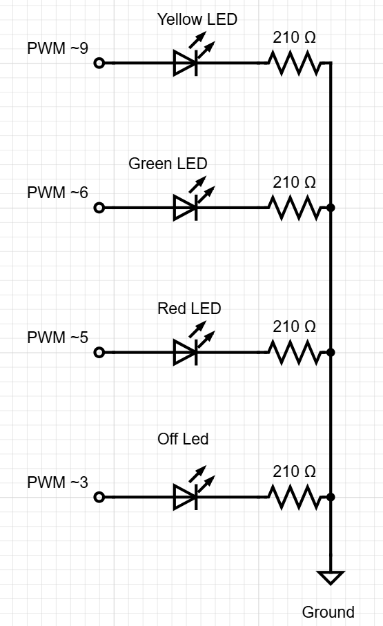
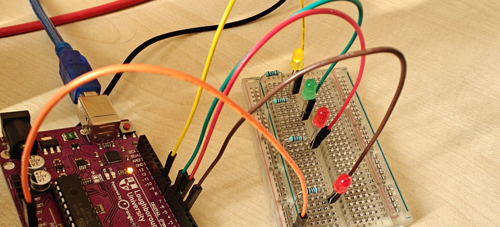
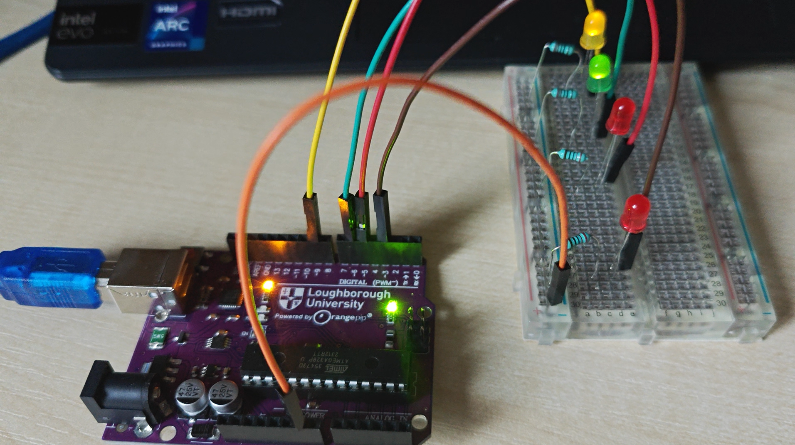

# Wiring (prototype)

Four LEDs on an Orangepip Kona328 (Arduino Uno clone, ATmega328), standing in for the final WS2812B ring.

## Connections

| Uno pin | LED | Used for |
|---|---|---|
| D9 (PWM) | Yellow | Clear, and part of cloudy |
| D6 (PWM) | Green | Rain, snow, and part of cloudy |
| D5 (PWM) | Red | Storm |
| D3 (PWM) | Red | Offline |

Each pin goes to an LED anode, the LED cathode goes to its own resistor, and all four resistors join one ground rail that returns to a GND pin on the Uno. The pins are defined in `firmware/include/config.h`.

All four pins are PWM-capable, so brightness is set with `analogWrite`. The firmware caps brightness with `maxBrightness` (128 out of 255) to keep the glow gentle.

## Resistors

- Value: 210 Ω at 1%, read from the colour bands (red, brown, black, black, brown). Not yet confirmed with a multimeter.
- Current: with typical forward voltages of about 2.0 to 2.2 V on a 5 V pin, each LED draws roughly 13 to 14 mA. These are estimates from typical values, not measurements.
- That is inside the Uno's 20 mA recommended limit per pin.

## Photos

| Clear (yellow LED) | Cloudy (yellow and green LEDs) |
|---|---|
|  |  |

## Fault found and fixed

An early layout had all four LEDs connected along the same line on the breadboard, so the branches were not independent and the LEDs did not light correctly. The serial output showed the firmware running normally, which pointed to the wiring. I isolated one LED, resistor and ground path at a time and rewired them separately.

Breadboard reminder: each numbered column is connected vertically in groups of five, not across the central trench, and the power rails run horizontally and may be split halfway along.
